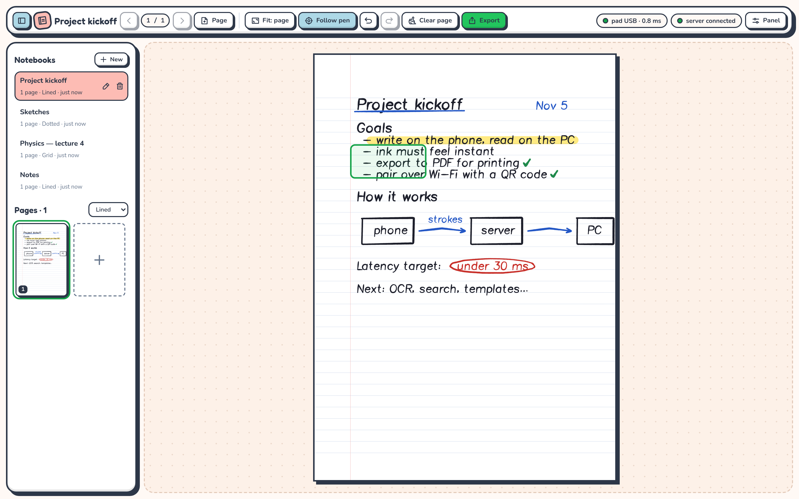
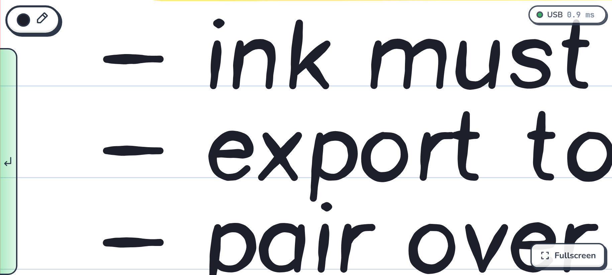
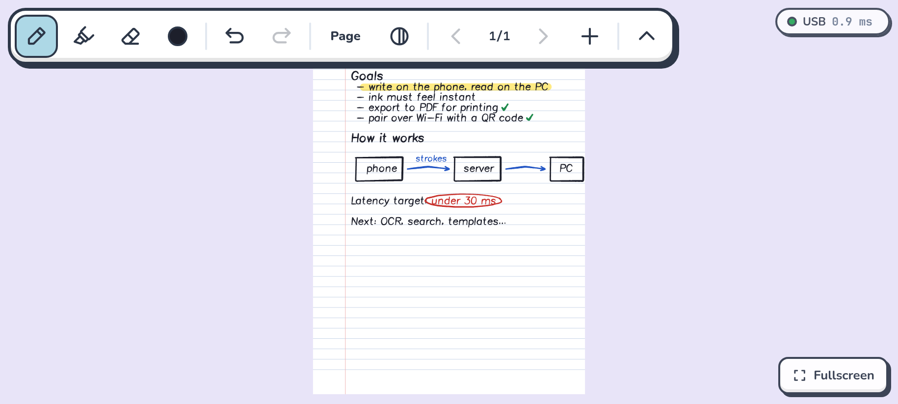
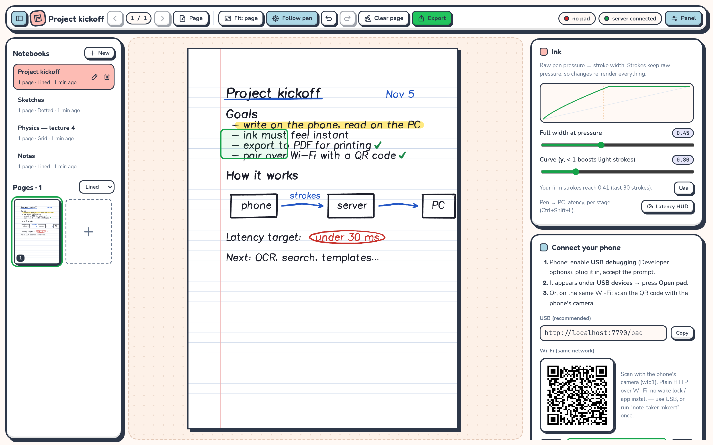
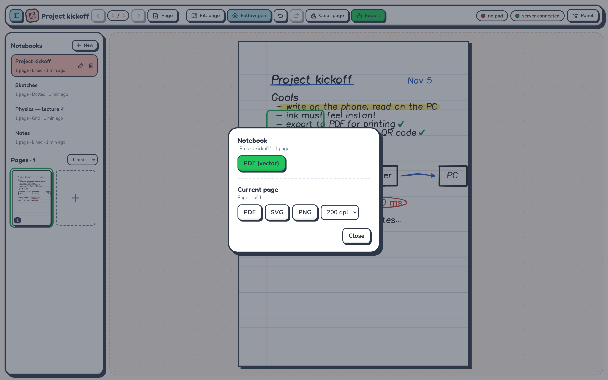

# note-taker

**Turn your phone and its stylus into a pen and paper for your PC.**

You write on the phone with the S Pen, and the ink shows up on your computer as you write. Notes are stored
on the PC as vector strokes, so you can organise them into notebooks, zoom without blur and export them to
PDF, SVG or PNG.



<p align="center">
  
  
</p>
<p align="center"><em>The phone: zoom-strip mode while writing (left) and whole-page mode with the toolbar (right)</em></p>

> **Status:** works day to day. It's built and tested on a Samsung Galaxy S23 Ultra with Chrome on Android
> and a Linux PC. Any phone or tablet with a stylus and a modern Chromium browser should work, but none
> other has been tested yet.

---

## Why

A phone with a stylus feels great to write on, but its screen is small, and the notes end up stuck in an
app on the phone. A PC has a big screen, a keyboard and your files, but no good way to write by hand.

note-taker uses both. **The phone is the paper and the PC is the notebook:**

- **Writing feels instant.** The phone draws your ink itself, straight away, without waiting for the
  network. The PC gets the same strokes a few milliseconds later.
- **The zoom strip makes a small screen big enough.** The phone shows a magnified window of a few lines of
  the page. When you reach the right edge it moves along by itself, and at the end of the line it wraps to
  the next one, like a typewriter. On the PC you write at normal handwriting size on a full A4 page.
- **Your notes live on your PC.** Everything is saved in one SQLite file on your machine. There's no
  account, no cloud and no app to install from a store.

## Features

**Writing (phone)**
- Pressure-sensitive ink drawn with [perfect-freehand](https://github.com/steveruizok/perfect-freehand),
  with a pressure curve you can tune on the PC
- Only the pen draws. Fingers pan and run gestures, so your palm doesn't leave marks
- Pen, highlighter (drawn under the ink) and stroke eraser, with 4 colours plus a custom one and 3 widths
- **Zoom-strip mode** (magnified, moves along as you write) or **whole-page mode**
- Two-finger tap to undo, three-finger tap to redo
- The toolbar hides when the pen touches down
- Blank-pad mode: the phone shows no ink and you watch the PC instead, like a graphics tablet
- Fullscreen, keeps the screen awake, and can be installed as an app from Chrome

**Reading and organising (PC)**
- The ink appears live while you write, and a cursor shows where the pen is hovering
- Notebooks with **A4 pages** or **endless pages**, on lined, grid, dotted or blank paper
- Page thumbnails, undo/redo shared with the phone, and fit to width or fit to page
- The strip rectangle shows where the phone is writing. You can drag it to move the phone's view
- A latency readout (`Ctrl+Shift+L`) that shows how long each stage of the pipeline takes

**Export**
- A whole notebook as a **vector PDF**, either as one tall page or cut into A4 sheets for printing
- The current page as **PDF**, **SVG** or **PNG** (100–300 dpi)

**Connecting**
- **USB** (recommended): the server runs `adb reverse` automatically when you plug the phone in
- **Wi-Fi**: scan a QR code shown on the PC. The link contains a token, so other devices on your network
  can't connect. HTTPS is optional, via [mkcert](https://github.com/FiloSottile/mkcert)

<p align="center">
  
  
</p>
<p align="center"><em>Pairing and ink settings (left) and export (right)</em></p>

## How it works

```
 Phone (Chrome)                     PC
┌───────────────────────┐        ┌────────────────────────────┐
│ /pad                  │  WS    │ Bun server :7777           │
│ • pen input → ink     │ ─────▶ │ • stores strokes (SQLite)  │
│   drawn on the phone  │ USB or │ • undo/redo history        │
│ • zoom strip          │ Wi-Fi  │ • sends them to the viewer │
└───────────────────────┘        │ • PDF / SVG / PNG export   │
                                 └─────────────┬──────────────┘
                                               │ WS
                                 ┌─────────────▼──────────────┐
                                 │ /viewer (app window)       │
                                 │ • full pages, live ink     │
                                 │ • notebooks, export        │
                                 └────────────────────────────┘
```

- Both the phone and the PC run plain **web pages** served by a small **Bun + TypeScript** server, so the
  phone needs no native app.
- The phone sends **vector strokes** (`x, y, pressure, time` for each point, in page units of 0.1 mm), not
  video. That uses very little bandwidth, and the ink stays sharp at any zoom.
- The server holds the real copy of every notebook. A client that drops its connection catches up from a
  snapshot, and strokes drawn while offline wait on the phone until the server confirms them.
- Over USB, `adb reverse` makes the PC reachable as `localhost` on the phone. That's the lowest-latency
  link, and Chrome treats `localhost` as a secure context, which is what fullscreen, keeping the screen
  awake and installing the app need.

The full design (protocol, data model, latency budget, milestones and the measurements from the S23 Ultra)
is in **[PLAN.md](PLAN.md)**.

## Getting started

### What you need

- A PC running Linux (macOS and Windows aren't tested yet, but nothing in the design is Linux-only)
- [Bun](https://bun.sh) 1.x
- Chromium or Google Chrome on the PC (for the viewer window)
- `adb` (Android platform tools) for USB
- A phone with a stylus and Chrome. It's built for the Galaxy S23 Ultra with the S Pen

### Install and run

```sh
git clone https://github.com/imRYiUK/note-taker.git
cd note-taker
bun install
scripts/note-taker            # starts the server and opens the viewer window
```

### Connect the phone over USB (recommended)

1. On the phone: **Settings → About phone → Software information**, then tap **Build number** 7 times to
   turn on Developer options.
2. **Developer options → USB debugging** on.
3. Plug the phone into the PC and accept the "Allow USB debugging" prompt.
4. In the viewer, open **Panel**. The phone appears under **USB devices**. Press **Open pad**.

### …or over Wi-Fi

Put the phone on the same network as the PC, open **Panel → Connect your phone** and scan the QR code with
the phone's camera.

Plain HTTP over Wi-Fi works for writing, but Chrome won't keep the screen awake or install the app without
HTTPS. To get those over Wi-Fi too, run `scripts/note-taker mkcert` once and follow its instructions to
trust the certificate on the phone.

> **Firewall:** if the phone can't reach the PC over Wi-Fi, allow ports **7777** (HTTP) and **7778**
> (HTTPS) in your firewall (for example `sudo ufw allow 7777,7778/tcp`).

### Tips

- On the phone, **install it as an app**: Chrome ⋮ menu → *Add to Home screen* / *Install app*.
- Tap the active tool (or the colour dot) to choose colours and widths.
- The toolbar hides while you write. Tap the handle, or swipe down from the top edge, to bring it back.
- If the S Pen's side button opens Air command, turn Air command off in
  *Settings → Advanced features → S Pen*.

## Keyboard shortcuts (viewer)

| Key | Action |
|---|---|
| `Ctrl+Z` / `Ctrl+Y` (or `Ctrl+Shift+Z`) | Undo / redo |
| `PageUp` / `PageDown` | Previous / next page |
| `Ctrl+PageDown` on the last page | New page |
| `Ctrl+E` | Export |
| `B` | Show / hide the notebook library |
| `F` | Fit to width / fit to page |
| `Ctrl+Shift+L` | Latency readout |

## Configuration

```sh
scripts/note-taker            # server + viewer window
scripts/note-taker --server   # server only
scripts/note-taker mkcert     # create an HTTPS certificate for Wi-Fi
bun run dev                   # server with auto-restart + browser console in the terminal
```

| Server flag | Effect |
|---|---|
| `--usb-only` | Listen on 127.0.0.1 only (no Wi-Fi) |
| `--no-adb` | Don't run `adb reverse` |
| `--no-https` | Ignore the HTTPS certificate |
| `--qr` | Print the Wi-Fi pairing QR code in the terminal |

| Environment variable | Default |
|---|---|
| `NOTE_TAKER_PORT` | `7777` (HTTPS uses port + 1) |
| `NOTE_TAKER_CONFIG_DIR` | `~/.config/note-taker` (`config.json`: port, Wi-Fi token, pressure curve; `tls/`) |
| `NOTE_TAKER_DATA_DIR` | `~/.local/share/note-taker` (`notes.db`: notebooks, strokes, undo history) |
| `NOTE_TAKER_TLS_CERT` / `NOTE_TAKER_TLS_KEY` | `tls/cert.pem` / `tls/key.pem` in the config dir |

Export is also available by URL: `/api/export/<notebookId>.pdf[?split=1]` and
`/api/export/<pageId>.{svg,pdf}` (add `?download=1` to name the file after the notebook).

## Project layout

```
src/
  shared/   protocol, ink rendering, zoom-strip logic, templates, QR, hit testing (used everywhere)
  server/   Bun HTTP + WebSocket server, SQLite store, notebooks & undo, export, adb, networking
  pad/      the phone page: pen input, canvas, gestures, toolbar
  viewer/   the PC page: renderer, notebook library, panel, export, latency readout
  probe/    a test page that reports what the phone's browser supports
scripts/    the note-taker launcher
test/       unit and server tests (bun test)
```

## Development

```sh
bun test            # unit + server tests
bun run typecheck   # TypeScript
```

## Latency

The goal is under **30 ms** from pen to PC screen over USB and under **50 ms** over Wi-Fi. Press
`Ctrl+Shift+L` in the viewer to see how long each stage takes: pen → ink on the phone, pen → server,
server → frame on the PC, and the total.

## Roadmap

Done: live ink, saving and undo, zoom strip, notebooks and templates, writing polish, export and Wi-Fi
pairing (milestones M0–M6 in [PLAN.md](PLAN.md)). Ideas for later:

- Lasso select to move, recolour or delete strokes
- A precise eraser that cuts through strokes
- Typed text boxes alongside handwriting
- Importing images or PDFs (lecture slides) to write on
- Handwriting recognition and search
- Markdown / Obsidian export
- A native Android app for lower latency and S Pen button events
- Several phones or tablets on one notebook
